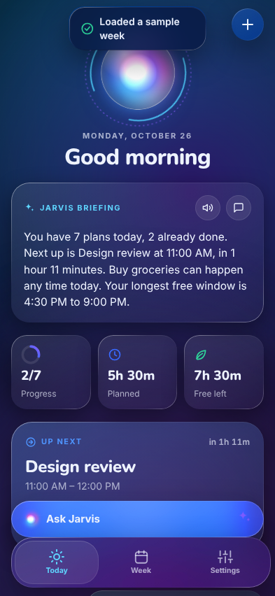
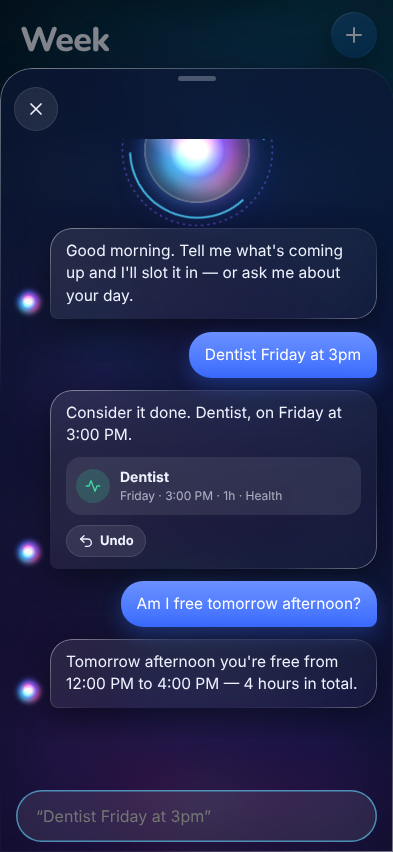
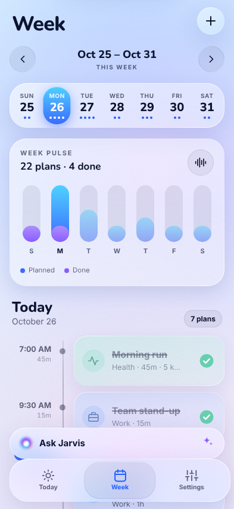
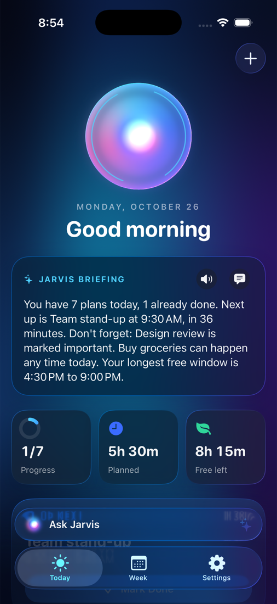
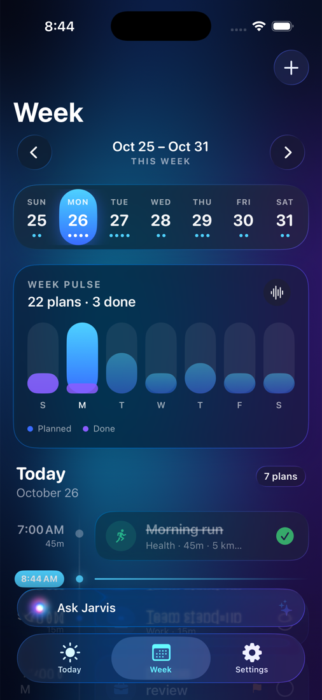
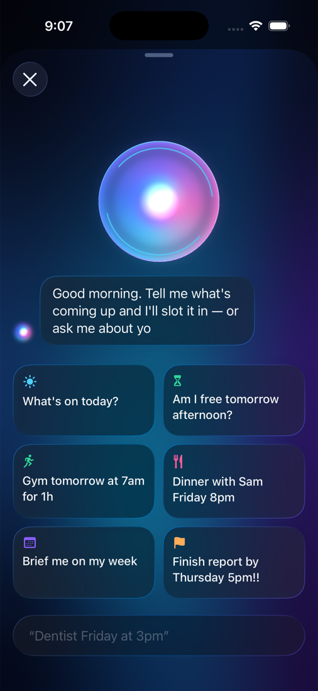
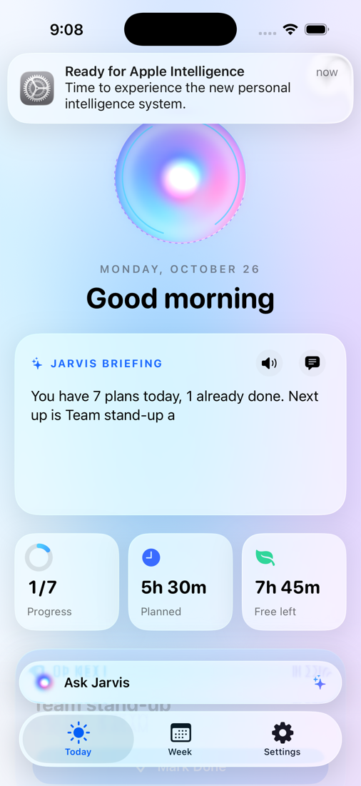
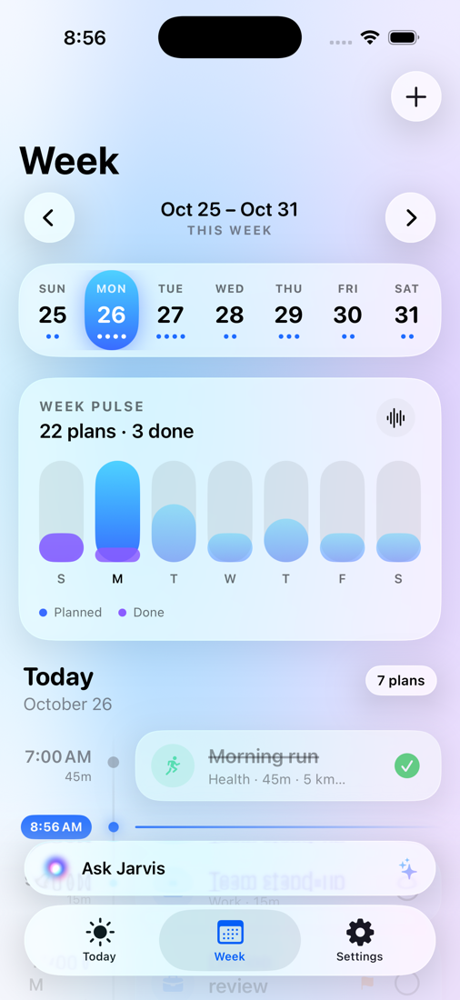
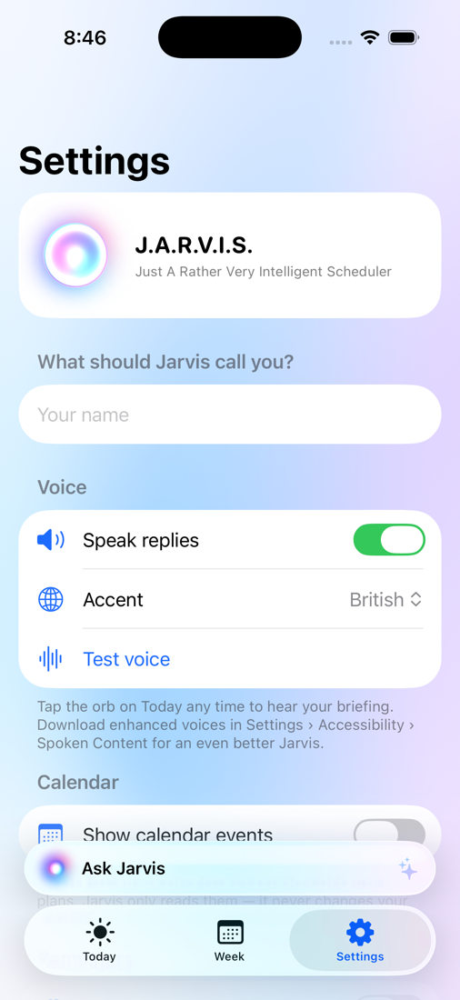

# Jarvis — your everyday planning assistant

Jarvis shows what you have to do today and this week, understands plain-English plans, reads
your briefing out loud and keeps everything moving with smooth, physics-based animation. It
comes in two forms:

- **Native iOS 26 app** (`Jarvis/`): SwiftUI with real Liquid Glass. Building it needs a Mac,
  or GitHub's cloud Macs plus Sideloadly on Windows (see below).
- **Web app** (`web/`): the same planner in one HTML file. It runs on an iPhone, a Windows
  PC or anything else with a modern browser. No Mac needed.

## No Mac? Run Jarvis on your iPhone or Windows PC

<p align="center">
  
  
  
</p>

**1. Web app through your Claude account (easiest).** Open the Jarvis link from your Claude
conversation on your iPhone (in the Claude app or Safari) or in any browser on Windows. You'll
need to be signed in to claude.ai. Your plans sync between your devices through your Claude
account. In Safari you can use *Share → Add to Home Screen* for a one-tap icon.

**2. Web app as a plain file (works offline).** On Windows: on GitHub, click *Code → Download
ZIP* for this branch, unzip it, and double-click `web/index.html`. Plans are saved in that
browser. To install it on an iPhone as a full-screen home-screen app, host the `web/` folder on
any static web host (for example GitHub Pages), open it in Safari and choose *Add to Home Screen*.

**3. The native app, built in the cloud and installed from Windows.** You'll need iOS 26 on the
iPhone, a Windows PC, a USB cable and a free Apple ID.
1. On GitHub, open **Actions → Build**, pick the latest green run and download the
   **Jarvis-ipa** artifact. You must be signed in to GitHub. Unzip it to get `Jarvis.ipa`.
2. On Windows, install [Sideloadly](https://sideloadly.io). Also install iTunes and iCloud,
   the versions from Apple's website, not the Microsoft Store.
3. Connect the iPhone, drag `Jarvis.ipa` into Sideloadly, enter your Apple ID and press
   **Start**.
4. On the iPhone, turn on *Settings → Privacy & Security → Developer Mode*. Then trust your
   Apple ID under *Settings → General → VPN & Device Management*.

With a free Apple ID the app has to be re-installed every 7 days. A paid Apple Developer
account ($99/year) lasts a year.

<p align="center"></p>

<p align="center">
  
  
  
</p>
<p align="center">
  
  
  
</p>

## Features

**Today**
- A living Jarvis orb: a swirling plasma core behind a Liquid Glass sphere with orbiting HUD
  rings. Tap it to hear your briefing; it spins up while Jarvis talks.
- A briefing that types itself out: what's next, what's done, what's important and your
  longest free window.
- Glass stat tiles (progress ring, planned time, free time left) and a hero "Happening now / Up
  next" card with a live progress bar.
- A timeline with a glowing rail, a live "now" marker and glass cards. Tap to edit, tap the
  circle to complete (with haptics and a bounce), long-press for Move to Tomorrow, Duplicate
  and Delete.

**Week**
- A glass day strip whose selection capsule glides between days. Swipe it to change week.
- A "Week pulse" bar chart of planned vs. done per day. Tap a bar to jump to that day.
- Day sections blur-transition as you move between days.

**Ask Jarvis** (the glass bar above the tab bar)
- Type naturally and see a live preview of what Jarvis understood before you send:
  - `Gym tomorrow at 7am for 1h`
  - `Team meeting friday 10:30-11:15 #work`
  - `Dentist next tuesday 3pm!` (a trailing `!` marks it important)
  - `Call mom tonight` · `Pay rent oct 31` · `Coffee in 30 min` · `Exam on the 30th`
- Ask questions: `What's on tomorrow?`, `Am I free friday afternoon?`, `Brief me on my week`.
- `Call me Joel` sets your name for greetings.
- The send button morphs out of the text field using `GlassEffectContainer` and `glassEffectID`.
  Undo is one tap.

**Also**
- Calendar events (EventKit, read-only) appear alongside your plans.
- Optional reminders before each timed plan.
- A British voice by default; American, Australian, Irish and Indian accents are available.
- Light and dark appearances are drawn over an animated mesh-gradient aurora.
- Respects Reduce Motion. Data is stored on-device with SwiftData.
- "Load a sample week" lets you explore the app straight away.

## Run the native app from Xcode (on a Mac)

Requirements: **Xcode 26** or later and **iOS 26** or later (Liquid Glass APIs).

1. Open `Jarvis.xcodeproj` in Xcode 26.
2. Select the **Jarvis** target → *Signing & Capabilities* → choose your Team. If the bundle ID
   `com.joelin.jarvis` is taken, change it to something unique.
3. Pick an iPhone simulator or your device and press **⌘R**.
4. On first launch, tap **Load a sample week** (or open **Ask Jarvis**) to get started.

To run on your own iPhone, enable *Developer Mode* on the phone (Settings → Privacy & Security).

## Project layout

```
Jarvis/
  App/            JarvisApp (entry point), RootView (tabs, glass accessory, sheets)
  Models/         Plan (SwiftData), categories, AgendaItem, formatting & theme
  Services/       PlanParser (natural language), Briefing (what Jarvis says),
                  CalendarService (EventKit), JarvisVoice (speech),
                  ReminderScheduler (notifications), JarvisStore, SampleData
  Views/
    Today/        Orb header, briefing, stats, focus card, timeline
    Week/         Day strip, week pulse chart, day section
    Ask/          Conversational assistant with live parsing preview
    Editor/       Create / edit plan sheet
    Settings/     Name, voice, calendar, reminders, data
    Components/   Aurora background, Jarvis orb, typewriter text, glass cards
web/
  index.html      The web app: markup, glass styles and all logic in one file
  manifest.webmanifest, sw.js, icons/   Home-screen install and offline support
  tests/          Parser and briefing tests (node --test web/tests/core.test.mjs)
```

The web app is a port of the Swift app. It uses the same natural-language parser and briefing
rules, the same categories and colors, and the same Today, Week, Ask Jarvis and Settings
screens. It doesn't read the system calendar or send reminder notifications, because browsers
can't do those things for a page like this.

The project uses Xcode's synchronized folders, so new files in `Jarvis/` are picked up
automatically. On every push, CI builds the app for the iOS Simulator, builds an unsigned
`Jarvis.ipa` for sideloading and runs the web app tests (`.github/workflows/build.yml`). To refresh the screenshots above, run the *Screenshots*
workflow or push a commit whose message contains `[screenshots]`.
